<!-- ═══════════════ HEADER ═══════════════ -->

  

  

  
  
  
  
  

<!-- ═══════════════ PIPELINE (animated, local file: assets/pipeline.svg) ═══════════════ -->

  

 

<!-- ═══════════════ STACK ═══════════════ -->
<h3 align="center">🧠 &nbsp;AI &amp; Machine Learning</h3>

   
  
  
  
  
  
  

<h3 align="center">📊 &nbsp;Data Engineering &amp; BI</h3>

   
  
  
  
  
  

<h3 align="center">⚙️ &nbsp;Back-end &amp; Languages</h3>

  

<h3 align="center">🌐 &nbsp;Front-end &amp; Mobile</h3>

  
  

<h3 align="center">🗄️ &nbsp;Databases</h3>

   
  
  
  
  

<h3 align="center">☁️ &nbsp;Cloud &amp; DevOps</h3>

   
  
  

<h3 align="center">🧩 &nbsp;Specialties</h3>

  
  
  
  
  

 

<!-- ═══════════════ ACTIVITY ═══════════════ -->

  
  

  

  

